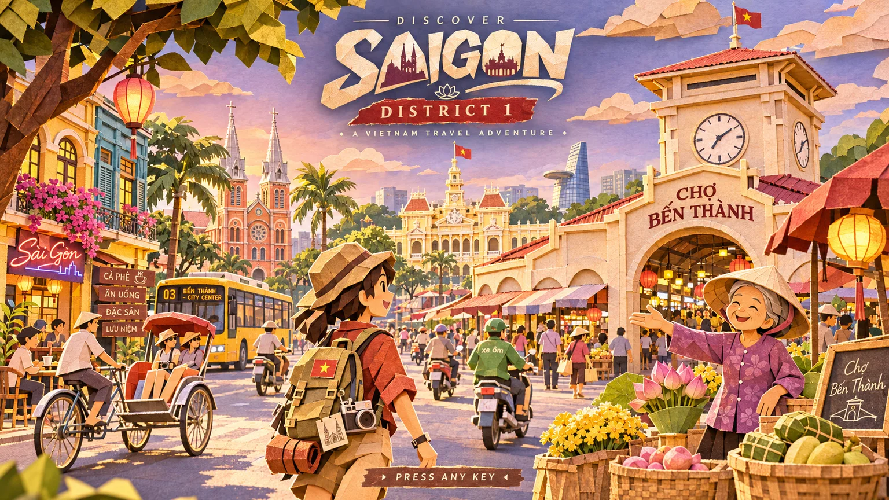
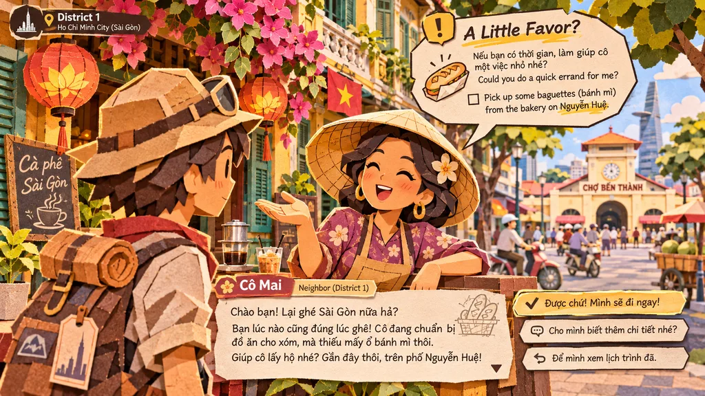
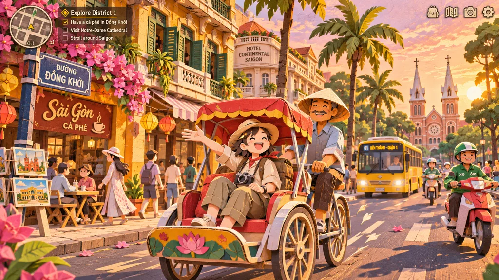
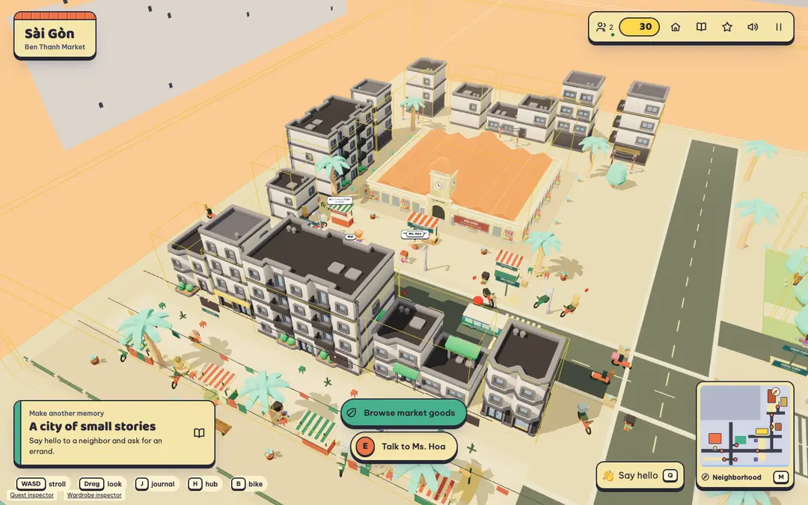
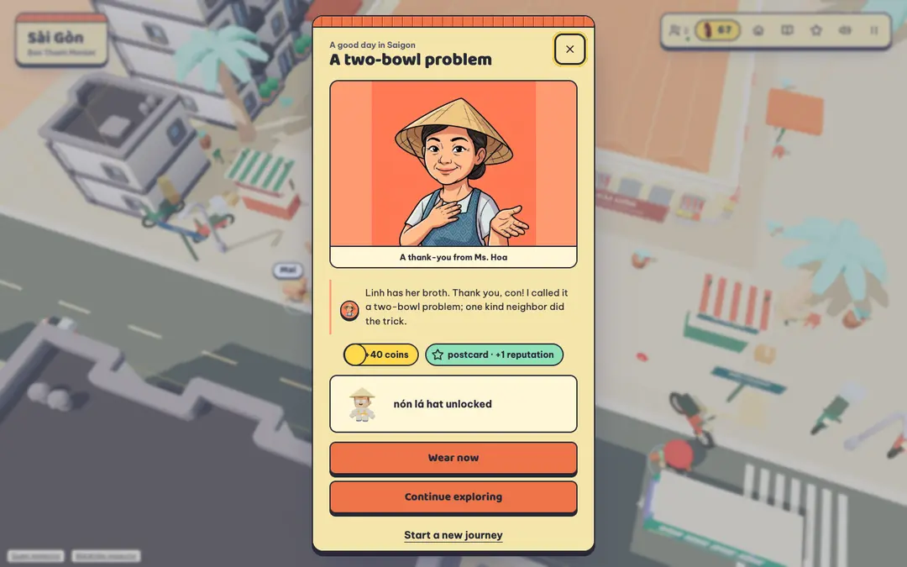
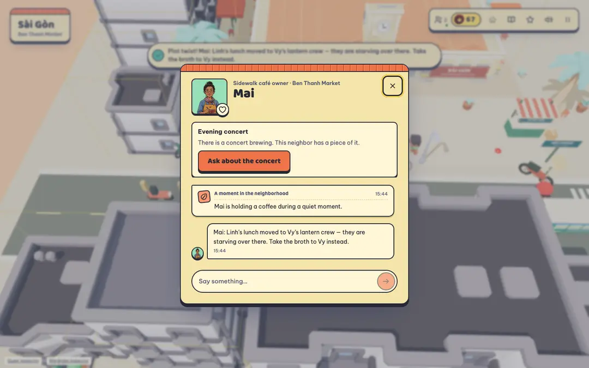

# Sài Gòn · A little journey

> **Be the neighbor who carries a small kindness across a living city.**
> Wander the warm paper streets of District 1 Sài Gòn, meet the people who live there,
> run a few errands, catch a ride, and collect a little piece of the city to call your own.

  <strong><a href="https://saigon-tour.toanz.workers.dev/?demo">▶ Play the demo in your browser</a></strong>
  &nbsp;·&nbsp; No install &nbsp;·&nbsp; Desktop &amp; mobile &nbsp;·&nbsp; English &amp; Tiếng Việt

---

## A city that talks back

There is no health bar, no timer, no fight to win. Just a lively neighborhood and the
quiet pleasure of being useful. Every few seconds you make a small choice — turn a corner,
greet a stranger, hop a cyclo, or chase a clue — and the city answers.

Your journey begins in front of **Chợ Bến Thành**, where **Cô Hoa** is waiting with a smile
and a small favor to ask. What happens next is up to you.

## What you'll do

🧭 **Explore a hand-crafted District 1.** Eight iconic stops — the market, the walking street,
City Hall, Notre-Dame Cathedral, the riverside, and more — rendered as a warm papercraft
diorama you can lose an afternoon in.

💬 **Meet 29 neighbors with real personalities.** Each one remembers you, warms to you over
time, and speaks for themselves — their errands, their moods, and their secrets are their own.
Help enough, and friendship opens new favors and gifts.

🛵 **Take a ride — and choose wisely.** Walk for free, or spend a few coins on a cyclo, a city
bus, a xe ôm, or the metro. Clever travelers read the map and spend less. Every ride animates
you through the living district.

🎁 **Earn rewards and dress up.** Finish an errand and a neighbor thanks you with coins,
reputation, and a gift — hats, outfits, accessories, rides, and follower pets. Try them on in
a 3D fitting room and wear what you love.

🌆 **Share the street with other players.** Drop into a shared room, wave, chat, and team up
for errands. A living **City Director** stirs up festivals, market rushes, rain, and street
music, so the neighborhood is never quite the same twice.

🥽 **Step inside in VR.** WebXR support brings controller movement and world-space conversations.
_(Physical Quest 3 performance is still being tuned.)_

## How to play

| Action          | Desktop             | Mobile             |
| --------------- | ------------------- | ------------------ |
| Move            | `WASD` / Arrow keys | Movement pad       |
| Run             | Hold `Shift`        | —                  |
| Look around     | Drag                | Drag               |
| Interact / talk | `E`                 | Interaction button |
| Journal         | `J`                 | On-screen          |
| Map             | `M`                 | On-screen          |
| Close / pause   | `Esc`               | On-screen          |

**[▶ Start your journey →](https://saigon-tour.toanz.workers.dev/?demo)**

## See it in action

Gameplay captures from a local QA run — the opening, a completed delivery, and a story twist.
_(Debug inspector controls are visible in these captures. Demo video: pending recording.)_

---

## About this project

**Sài Gòn · A little journey** was built for the **Meta Global AI Developer Hackathon**
(October 27 – November 4, 2026). Its neighbors are live AI agents powered by Meta Muse Spark:
they hold conversations, propose quests, remember what you tell them, and decide how they feel
about you — all validated by shared game rules so the world stays fair.

Created by **Toàn** ([toanzzz](https://github.com/toanzzz)).

Builders, operators, and the curious — everything technical lives in
**[Development & operations](docs/development.md)**:

- [Run it locally & develop](docs/development.md#run-locally)
- [How the Meta models are used](docs/development.md#how-meta-models-are-used)
- [Hosting & deployment](docs/development.md#hosting)
- [Design and controls](docs/game-design.md) · [Architecture](docs/architecture.md) · [Meta integration](docs/meta-api.md)
- [Asset provenance](assets/LICENSES.md) · [Third-party notices](apps/client/public/THIRD_PARTY_NOTICES.txt)

Original source code is licensed under [Apache-2.0](LICENSE), copyright 2026 Toàn.
Bundled assets and dependencies retain their separate licenses; see the provenance inventory.
